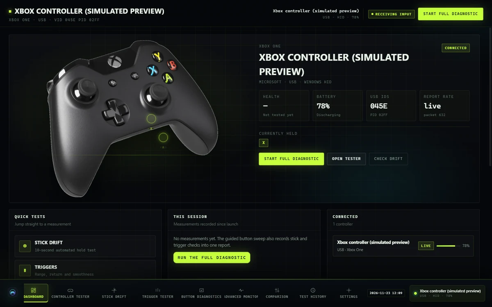
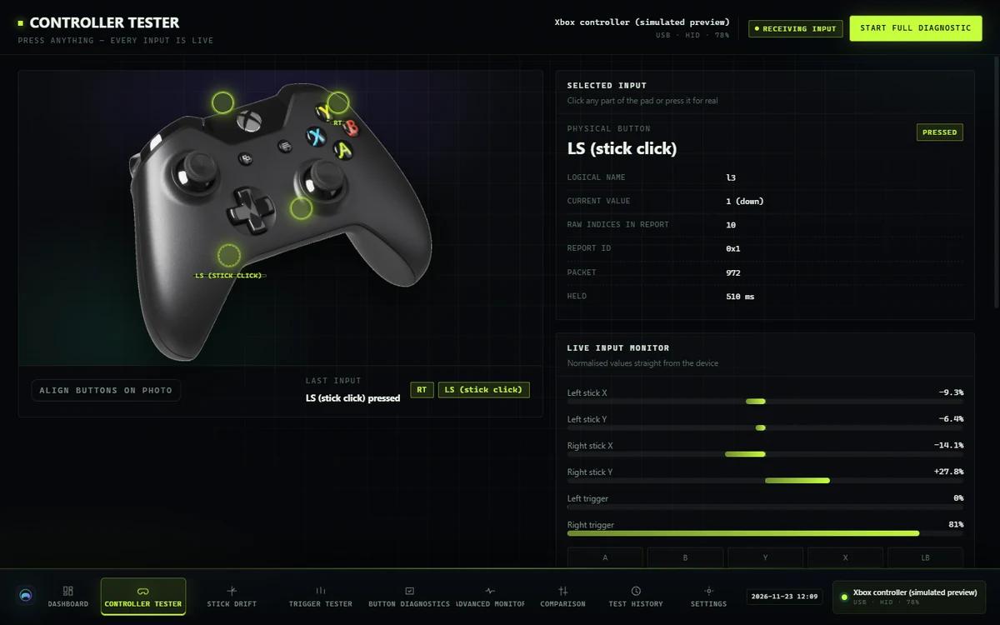
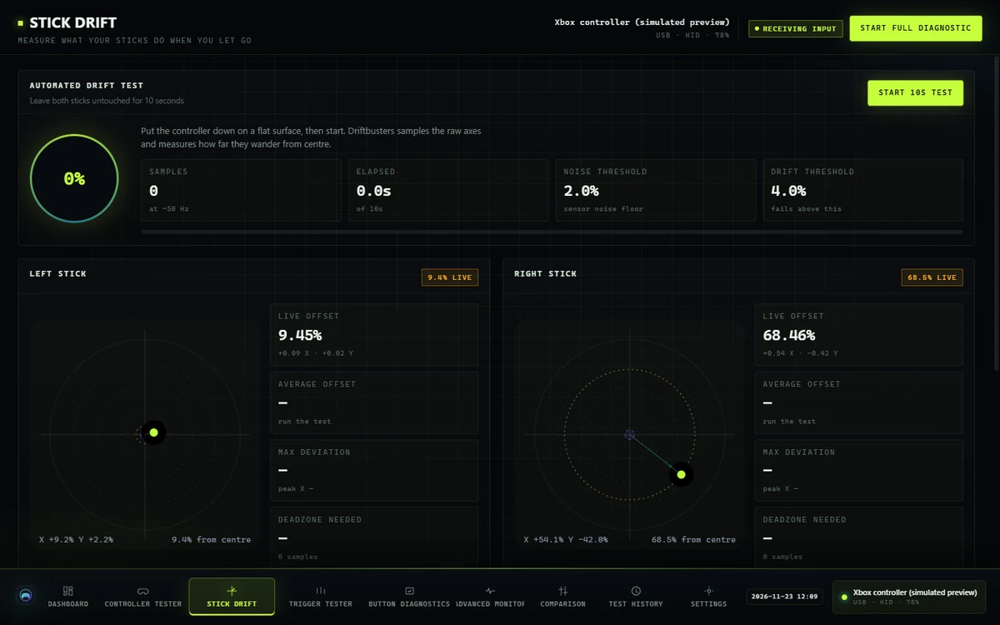

# Driftbusters

**A bench test in a window.** Plug in a controller, press the buttons, find out if it drifts.

Windows 10 / 11 · Tauri 2 + Rust · Works offline · No account, no telemetry

**[⬇ Download for Windows](https://github.com/nk12Kumar/driftbusters/releases/latest)** ·
[Portable](https://github.com/nk12Kumar/driftbusters/releases/latest/download/Driftbusters-Portable-1.0.0.exe) ·
[Installer](https://github.com/nk12Kumar/driftbusters/releases/latest/download/Driftbusters_1.0.0_x64-setup.exe)



## What it checks

| Screen | In one line |
| --- | --- |
| **Dashboard** | What's connected, battery, health score, recent reports |
| **Controller Tester** | Press anything — it lights up on a real photo of your pad |
| **Stick Drift** | 10-second hold test: offset, deviation, deadzone, verdict |
| **Trigger Tester** | Full range, return-to-zero, smoothness, stuck triggers |
| **Button Diagnostics** | Guided sweep, pass / fail per button, instant retest |
| **Advanced Monitor** | Button indices, raw axes, event log, hex report |
| **Comparison** | Two pads, same code path, side by side |
| **Test History** | Saved reports, health over time, PDF + CSV export |
| **Settings** | Thresholds, test length, remapping, button positions |

| | |
| --- | --- |
|  |  |

## Why the numbers mean something

- **Xbox pads** → XInput. `XInputGetStateEx` includes the Guide button; battery and VID/PID come from the API, never from the name string.
- **PlayStation + generic pads** → Windows HID. Documented DualShock 4 / DualSense report layouts, usage-table decoding for everything else.
- **Hot-plugging** → HID interfaces and XInput slots are re-enumerated every 700 ms. No restart, no refresh button.

Sampling runs on its own thread at ~60 Hz, so the interface never stutters while a test is measuring.

## Install

**Installer** — per-user, no admin rights, Start-menu entry.
**Portable** — one `.exe`, nothing to install. Settings and reports stay in `DriftbustersData` beside the file, so a copied folder keeps your history.

Reports live in `%APPDATA%\com.driftbusters.app\history.json`. Nothing leaves the machine.

## Build it

```bash
npm install
npm run tauri dev      # desktop app with hot reload
npm run tauri build    # Windows installer + exe
```

No controller at hand? The dev server accepts `?mock=1` for a clearly labelled simulated pad — dev builds only.

## Status

| | |
| --- | --- |
| Simulated input, all nine screens | ✅ verified |
| Drift test timing (255 samples / 10 s) | ✅ verified |
| Real Xbox pad | ⏳ hardware pass in progress |
| PDF / CSV export dialogs | ⏳ not exercised yet |
| Two pads at once | ⏳ needs a second controller |
| Linux | ⏳ not started |

## Known limits

- Guide button relies on the undocumented `XInputGetStateEx` — very old drivers may not expose it.
- Windows doesn't always say USB vs Bluetooth, so the connection field can honestly say *unknown*.
- Battery appears only when the pad reports it.
- Touchpad, motion sensors and DualSense adaptive-trigger effects are not read.

## Credits

Controller photography is public domain / CC0 from Wikimedia Commons — see [ATTRIBUTIONS.md](ATTRIBUTIONS.md).
Not affiliated with Microsoft or Sony. "Xbox", "PlayStation", "DualSense" and "DualShock" are their trademarks.
